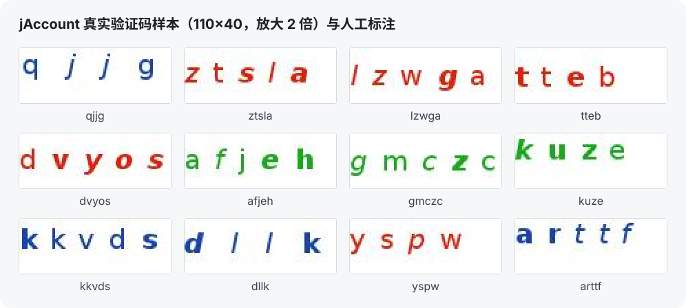
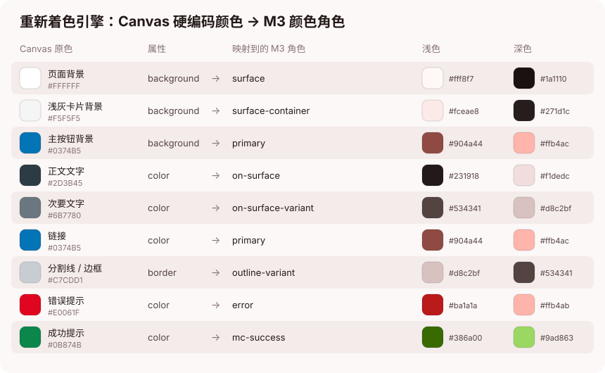

## 写在前面

在交大，每天打开浏览器的前两步几乎是固定的：

1. 登录 jAccount —— 输完账号密码，还要盯着一张小图片敲 4~5 个字母；
2. 打开 Canvas（[oc.sjtu.edu.cn](https://oc.sjtu.edu.cn)）—— 一个配色和交互都停留在很多年前的界面，夜里打开还会被一整屏白光闪到。

这两件事都不大，但每天都要做，于是我写了两个用户脚本（Tampermonkey / Violentmonkey 可用）：

| 项目 | 解决什么问题 | 仓库 |
| --- | --- | --- |
| **jAccount 验证码自动填写** | 登录页自动识别验证码并填入 | [cristimezzz/jaccount-captcha-autofill](https://github.com/cristimezzz/jaccount-captcha-autofill) |
| **Materialized Canvas** | 给 Canvas 换上 Material Design 3 外观，支持深色模式 | [cristimezzz/MaterializedCanvas](https://github.com/cristimezzz/MaterializedCanvas) |

这篇文章不打算写成使用说明（README 里都有），而是聊聊做的过程里是怎么想的、踩了哪些坑。

---

## 一、jAccount 验证码自动填写

### 1.1 目标：小、快、离线、不打扰

一开始给自己定了几条约束，后面几乎所有设计都是从这里推出来的：

- **不自动提交**。脚本只填验证码，登录按钮还是自己点。它不应该变成一个"自动登录器"。
- **不发任何网络请求**。不加载 CDN 上的推理框架，不下载模型，也不重新请求验证码图片（重新请求会让验证码变掉）。
- **不覆盖用户输入**。如果我已经手动敲了，脚本就别动。
- **够快**。打开页面时就应该已经填好了。

早期的版本借用了 [ddddocr](https://github.com/sml2h3/ddddocr) 的通用 OCR 模型，能用，但这是一个面向各种验证码的大模型，字符表有几千个类别，还得额外带一个 ONNX 运行时。对一个"只认小写字母"的场景来说，太重了。于是决定：**针对 jAccount 的验证码，自己训练一个专用小模型，然后用纯 JS 在浏览器里推理。**

### 1.2 先观察验证码长什么样

训练模型之前，先要搞清楚数据。我以很低的频率（每 2.5 秒一张）采集了 150 张真实验证码，写了 `tools/analyze_real.py` 统计尺寸、颜色和字符位置：



统计下来，这个验证码其实相当"干净"：

- 110×40 的 JPEG，白底，**没有噪点和干扰线**；
- 4~5 个小写字母；
- 字体是 **DejaVu Sans**（Java 的 `SansSerif` 在 Linux 上的默认映射），每个字符随机常规 / 粗体 / 斜体 / 粗斜体；
- 每张图只有一种颜色，分蓝 ≈ (44,67,136)、红 ≈ (178,52,44)、绿 ≈ (53,152,58) 三族；
- 字符按字宽依次排列，字间距每张图不同，整体有一个垂直偏移。

这 150 张图**不用来训练**，只做两件事：校准合成参数，以及做最终的测试集。标注时先用 ddddocr 和模型分别预标注，两边一致的默认采纳，不一致的在一个本地 `review.html` 页面里高亮出来人工确认。

### 1.3 用合成数据训练

既然字体、颜色、排布规律都摸清了，那最省事、也最"礼貌"的办法就是**自己造数据**：`train/synth.py` 用 Pillow 按上面的统计结果画验证码 —— 同样的字体、同样的三族颜色（再加一点抖动）、同样范围的字间距和垂直偏移，最后再做一次随机质量的 JPEG 压缩。

这样做的好处很明显：

- 数据无限、标签 100% 正确；
- 不需要对学校服务器发起成千上万次请求；
- 训练是一个无限流的 `IterableDataset`，不存在过拟合到某个固定训练集的问题。

参数上我刻意比真实分布"放宽"了一点（字号 20~24、偏移范围更大），让模型对页面将来的小改动更鲁棒。

### 1.4 模型：为"能用纯 JS 实现"而设计

模型结构的第一原则不是精度，而是**推理端好实现**。所以 `CaptchaNet` 只用了 5 种算子：`Conv2d`、`BatchNorm`、`ReLU`、`MaxPool`、`Conv1d`。

```
输入 1×40×110（灰度取反，墨迹 = 1）
 ├─ Conv3×3(16) → Pool 2×2      → 20×55
 ├─ Conv3×3(32) → Pool 2×2      → 10×27
 ├─ Conv3×3(64) → Pool 2×1      → 5×27
 ├─ Conv3×3(96)
 ├─ 把高度维并入通道：96×5 → 480 通道 × 27 个时间步
 └─ Conv1d ×2 → Conv1d(27)      → 27 步 × (blank + a-z)
CTC 贪心解码
```

几个考虑：

- **CTC 而不是"切字符再分类"**：字符间距每张图都不同，有时还挨在一起，切分本身就是个难题。CTC 让模型自己决定每个时间步输出什么，长度 4 还是 5 也不用额外处理。
- **全卷积、没有 RNN**：LSTM 在 JS 里手写起来麻烦，而这个任务字符之间几乎没有上下文依赖，几层 1D 卷积的感受野已经足够。
- **约 25 万参数**：在合成验证集上很快收敛，在 150 张真实样本上测试是 **150/150**。

### 1.5 把模型塞进一个 userscript

训练完的模型要变成一个"单文件、无依赖"的脚本，中间有几步：

1. **折叠 BatchNorm**：推理时 BN 就是一个逐通道的仿射变换，直接乘进前一层卷积的权重和偏置里，JS 端就少一种算子。
2. **fp16 + base64**：25 万个参数用 fp16 存约 500 KB，base64 后内联进脚本，最终脚本约 700 KB，低于 Greasy Fork 2 MB 的上限。
3. **纯 JS 推理**：`src/infer.js` 手写了 3×3 卷积、池化、1D 卷积和 CTC 解码，不到两百行，单张识别在电脑上约 20 ms。
4. **一致性测试**：`export_weights.py` 会用 numpy 按"折叠 + fp16 往返后"的权重复现一遍前向，和 PyTorch 对比；`test/js_parity.js` 再比较 JS 输出和 PyTorch 输出；`test/real_eval.js` 则直接**从构建产物里**抠出推理代码去跑真实测试集 —— 测的就是用户要安装的那个文件。

Greasy Fork 对内联数据比较敏感，所以权重按 100 字符分行，并在旁边写清楚注释：这一大段 base64 只会被解码成 `Float32Array` 做矩阵运算，脚本里没有 `eval`、`new Function` 或动态脚本注入。

### 1.6 页面交互的小细节

模型之外，真正决定"好不好用"的是这些边角：

- 直接把页面上**已经加载好的** `` 画到 canvas 上取像素（同源，不会污染 canvas），不额外请求；
- 用 `load` 事件 + `MutationObserver` 监听 `src` 变化，点图片换一张后自动重新识别；
- 用一个递增的序号丢弃过期的识别结果，避免快速连点时旧结果覆盖新结果；
- 记录"上次是脚本填的值"，只有输入框为空或仍是脚本填的值时才覆盖；
- CTC 解码时顺便算出每个字符的**置信差**（最高分和次高分之差），太小就在状态栏里提示"把握不大"，结果不是 4~5 个小写字母就直接提示换一张。

---

## 二、Materialized Canvas

### 2.1 问题：颜色是"写死"的

想给 Canvas 换个主题，第一反应是写一堆 CSS 覆盖。但翻一翻 Canvas 的样式就会发现这条路走不通：

- Canvas 的老样式是大量编译好的 CSS bundle，颜色以 `#2D3B45`、`#0374B5` 这样的字面量写死在**成千上万条选择器**里；
- 新一些的组件来自 InstUI，它把每个组件的主题以 CSS 变量的形式挂在 `:root` 上，但变量名带着一个 5 位哈希（比如 `--fQfxa-primaryBackground`），**每次 Canvas 发版哈希都会变**。

手写覆盖规则既写不完，也维护不动。所以这个项目的核心思路是：**不手写颜色覆盖，而是在浏览器里把 Canvas 的样式表"读一遍"，自动生成覆盖规则。**

### 2.2 色板：从一个种子色生成整套 M3 颜色

Material Design 3 的配色是"动态"的：给一个种子色，用 [Material Color Utilities](https://github.com/material-foundation/material-color-utilities) 在 HCT 色彩空间里生成一整套颜色角色（`primary`、`surface`、`on-surface`、`outline-variant`……），浅色和深色各一套，还能调对比度。

`src/theme.ts` 做的就是这件事：默认种子色是交大红 `#C8161E`，生成 `--md-sys-color-*` 变量，分别挂在 `html[data-mc-theme="light"]` 和 `html[data-mc-theme="dark"]` 上。成功 / 警告 / 信息这几个语义色是固定色相，但会先 `harmonize` 到种子色附近，让它们和整体色板更协调。

### 2.3 重新写着色引擎

有了色板，剩下的问题就是：**Canvas 里每一个硬编码的颜色，应该变成哪个 M3 样式？**

`src/recolor.ts` 遍历每一张同源样式表的每一条规则，对每一个带颜色的声明，按两个维度来决定映射：

1. **这个属性在画什么**：背景（`background`、`fill`）、文字（`color`）、还是边框（`border`、`outline`）？对 InstUI 的变量，则根据变量名后缀（`...Background`、`...BorderColor`）判断 —— 只看后缀、不看哈希，所以 Canvas 升级也不怕。
2. **这个颜色本身是什么**：转到 HCT 空间，彩度很低的算中性色，按明度映射到 `surface` / `surface-container-*` / `on-surface` / `outline` 等；有彩度的按色相分到 `primary` / `error` / `success` / `warning` / `tertiary` 几族，再按明度选是 `container` 还是基础色。

然后用**同一个选择器**输出一条覆盖规则，值换成对应的 CSS 变量。下图是用引擎的实际代码跑出来的几个典型映射（种子色为交大红）：



这个设计有几个很舒服的性质：

- **生成的规则只引用变量**。换种子色、切深浅色，只需要换掉那一小段变量定义，覆盖规则本身一个字都不用改；
- **结果可以缓存**。Canvas 的 bundle URL 带指纹，所以按 URL 缓存生成结果。下次打开页面时在 `document-start` 阶段、页面绘制之前就把缓存的覆盖规则注入进去，避免先闪一下原始配色；
- **样式顺序固定**：`Canvas 原样式 → 每张原样式表对应的覆盖规则 → 主题变量 → 手写的 M3 样式`，由 `injector.ts` 用 `MutationObserver` 维护。

当然也有不能乱改的颜色：日历里的课程颜色、控制面板卡片的课程色都是用户自己选的，引擎会跳过这些选择器，只在深色模式下稍微压暗。

### 2.4 手工打磨

重新着色引擎解决的是"颜色对不对"，但 M3 的味道还来自形状、排版和动效。所以 `src/styles/` 下面还有一层手写样式：

- 全站：左侧全局导航改成 Navigation Rail、课程菜单改成抽屉、胶囊按钮、填充式输入框、圆角卡片与对话框；InstUI 的过渡曲线统一替换成 M3 的 emphasized 曲线；
- 逐页：控制面板、作业、评分、讨论、课程主页、文件、人员……每个页面一个 CSS 文件；
- 手机：窄屏下 Canvas 用的是另一套 DOM（`header#mobile-header`、InstUI Tray），也要单独适配。

写这些样式最花时间的其实是**读 DOM**。我把调研到的结构记在 `docs/selectors.md` 里，比如"单元页每个标题里同时有展开和折叠两个按钮，靠 `display` 隐藏其中一个，所以千万别给它们设 `display`"、"React 会重写 `className`，所以当前项标记要用 `data-*` 属性"。Canvas 下次改版时，这份笔记就是最好的起点。

### 2.5 深色模式的适配

样式表都改完了，深色模式下还会冒出"黑底黑字"：

- **老师写的富文本**（课程页面、公告、大纲）里有大量内联的 `style="color: ..."` 和 `<font color>`，样式表管不到它们。`darkContent.ts` 会扫描这些元素，用同一套映射规则改写内联颜色，并把原始样式存在 `data-mc-orig-style` 里，切回浅色时原样还原；
- **TinyMCE 编辑器**在一个 `about:blank` 的 iframe 里，userscript 本身不会在里面运行，所以要从外面把主题变量和一段编辑器样式塞进去。

### 2.6 一个开发上的小技巧

调试 userscript 时，最理想的是在已登录的真实页面里注入本地构建产物。但 Canvas 的 CSP 带了 `upgrade-insecure-requests`，页面没法直接从 `http://localhost` 拉脚本。最后的办法是让本地服务器把代码通过同源的 `robots.txt#mcdev=…` 地址交给页面，存进 `localStorage` 再执行 —— 绕开了 CSP，又不需要每次都重新安装脚本。

### 2.7 已知限制

- 跨域 iframe（LTI 工具、视频平台、PDF 预览）改不了样式；
- 教师端页面（SpeedGrader、成绩册等）目前只靠重新着色引擎兜底，没有逐页打磨；
- 第一次访问某个页面时，新的样式表需要处理一次，可能会闪一下原始配色，之后就走缓存了。

---

## 三、回头看

两个项目看起来毫不相干，一个是机器学习，一个是 CSS，但做下来思路其实很像：

- **先观察，再动手**。验证码先做统计分析再写合成器；Canvas 先摸清样式表和 DOM 结构再写引擎。花在"看"上的时间，最后都省在了"改"上。
- **规则化，而不是穷举**。不去爬几万张验证码，而是把规律写成合成器；不去手写几千条颜色覆盖，而是把规律写成映射函数。
- **约束决定设计**。"纯 JS、无依赖"决定了模型只能用最朴素的算子；"切换主题不重算"决定了覆盖规则只能引用变量。
- **对目标网站保持克制**。采集频率压得很低，脚本不自动提交、不发请求；美化脚本一键就能关掉、恢复原样。

## 安装

1. 安装 [Tampermonkey](https://www.tampermonkey.net/) 或 [Violentmonkey](https://violentmonkey.github.io/)；
2. jAccount 验证码：安装仓库里的 [`jaccount-captcha.user.js`](https://github.com/cristimezzz/jaccount-captcha-autofill/blob/main/jaccount-captcha.user.js)；
3. Materialized Canvas：点击 [安装脚本](https://github.com/cristimezzz/MaterializedCanvas/raw/main/dist/materialized-canvas.user.js)，打开 Canvas 后在左侧导航栏底部的「外观」里调整主色和深浅色。


欢迎在 GitHub 上提 Issue 或 PR。
